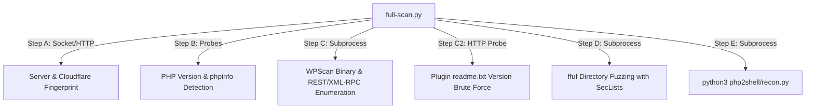
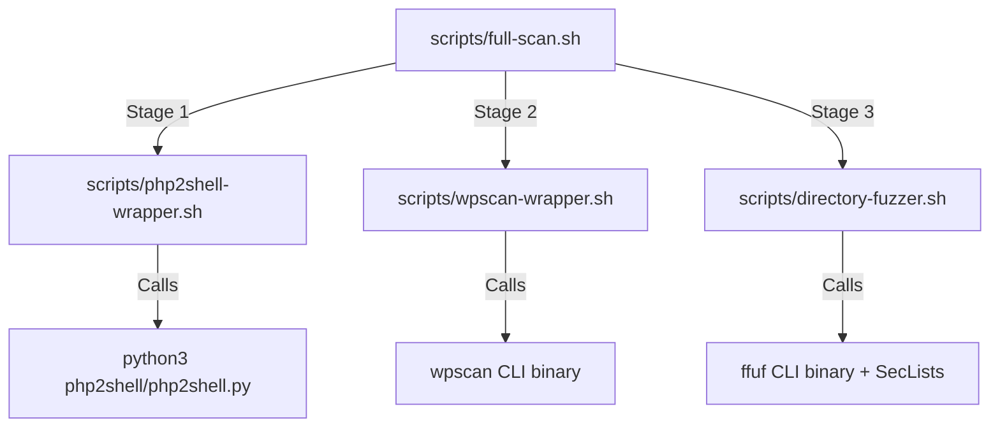

# PHP2SHELL - Security Scanning & Assessment Suite

A security assessment and vulnerability auditing toolkit for web applications and WordPress deployments. The project combines reconnaissance, web server fingerprinting, WordPress security auditing (WPScan), directory and file discovery (ffuf), and PHP environment exposure checks.

---

## 📁 Repository Architecture

The project is structured into three clean layers:

```
PHP2SHELL/
├── full-scan.py            # [Unified Python Orchestrator] Standalone 6-stage scanner (Steps A-E)
├── setup-full-scan.sh      # [Setup Script] Environment and dependency installer
├── scripts/                # [Shell Pipeline] Modular Bash wrapper scripts
│   ├── full-scan.sh        # Bash master pipeline that calls wrapper scripts
│   ├── wpscan-wrapper.sh   # WPScan CLI wrapper with API token management
│   ├── directory-fuzzer.sh # ffuf directory/file discovery wrapper using SecLists
│   ├── php2shell-wrapper.sh# PHP2Shell runner wrapper
│   └── setup-full-scan.sh  # Backup/standalone installer script
└── php2shell/              # [Core Assessment Engine] Python security modules
    ├── recon.py            # Step A/B: Server fingerprinting & PHP environment probe
    ├── php2shell.py        # Core assessment engine (CVE-2026-109618 / 109619 checks)
    ├── verify.py           # Result and artifact verification
    ├── requirements.txt    # Python package dependencies
    ├── docs/               # Technical vulnerability documentation
    └── wordlists/          # Targeted wordlists for discovery
```

---

## 🔄 How the Components Connect (Call Graph)

You have **two distinct ways** to run the project. They perform equivalent scans, allowing you to choose between a unified Python interface or modular Bash scripts:

### Pathway 1: Unified Python Scanner (`full-scan.py`)
`full-scan.py` is a standalone Python orchestrator that does not depend on the shell scripts. It directly invokes the underlying binaries:



### Pathway 2: Modular Bash Pipeline (`scripts/`)
The shell scripts provide a modular, pipe-friendly workflow:



---

## 🚀 Quick Start & Usage

### 1. Initial Setup
Run the setup script once to install all dependencies (Ruby, WPScan, ffuf, Python libraries, and SecLists):

```bash
chmod +x setup-full-scan.sh
./setup-full-scan.sh
```

---

### 2. Running the Unified Python Scanner (Recommended)

Run the full end-to-end scanner against your target:

```bash
# Full scan with WPScan API token
python3 full-scan.py https://example.com/blog/ --token "YOUR_WPSCAN_API_TOKEN"

# Scan without WPScan token (runs Steps A, B, C2, D, E)
python3 full-scan.py https://example.com/blog/ --skip-c

# Fast scan skipping long directory fuzzing
python3 full-scan.py https://example.com/blog/ --token "YOUR_TOKEN" --skip-d
```

#### Available CLI Flags:
- `--token <TOKEN>` : Set WPScan API token for vulnerability database lookups
- `--skip-a`        : Skip Cloudflare and server fingerprinting
- `--skip-b`        : Skip PHP version and probe detection
- `--skip-c`        : Skip WPScan enumeration
- `--skip-c2`       : Skip plugin `readme.txt` brute forcing
- `--skip-d`        : Skip `ffuf` directory discovery
- `--skip-e`        : Skip PHP2Shell vulnerability check

---

### 3. Running via Modular Shell Scripts

If you prefer using Bash or integrating individual tools into CI/CD pipelines:

#### Complete Pipeline:
```bash
export WPSCAN_TOKEN="your_wpscan_api_token"
./scripts/full-scan.sh https://example.com/blog/
```

#### Running Components Individually:
- **WPScan Only**:
  ```bash
  export WPSCAN_TOKEN="your_token"
  ./scripts/wpscan-wrapper.sh https://example.com/blog/
  ```

- **Directory & File Fuzzing Only**:
  ```bash
  ./scripts/directory-fuzzer.sh https://example.com/
  ```

- **PHP2Shell Exposure Reconnaissance Only**:
  ```bash
  python3 php2shell/recon.py https://example.com/ --json
  ```

---

## 🛡️ Remediation & Security Hardening

When security audits identify vulnerabilities, apply the following mitigations:

1. **PHP Session Upload Progress (CVE-2026-109618 / CVE-2026-109619)**:
   - Upgrade PHP to patched releases:
     - PHP 8.2: `>= 8.2.35`
     - PHP 8.3: `>= 8.3.36`
     - PHP 8.4: `>= 8.4.27`
   - In `php.ini`, disable upload progress if not required:
     ```ini
     session.upload_progress.enabled = Off
     ```
2. **WordPress Security**:
   - Disable XML-RPC (`xmlrpc.php`) if unused.
   - Restrict enumeration of `/wp-json/wp/v2/users`.
   - Keep plugins and themes updated to their latest versions.
3. **Information Disclosure**:
   - Remove any publicly accessible `phpinfo.php`, backup files (`.bak`, `.old`), and database dumps (`.sql`).
